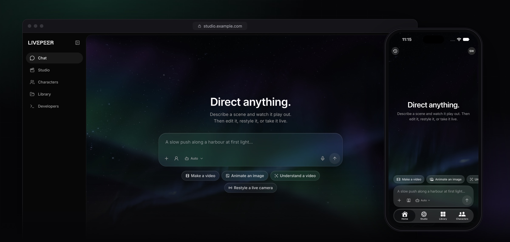
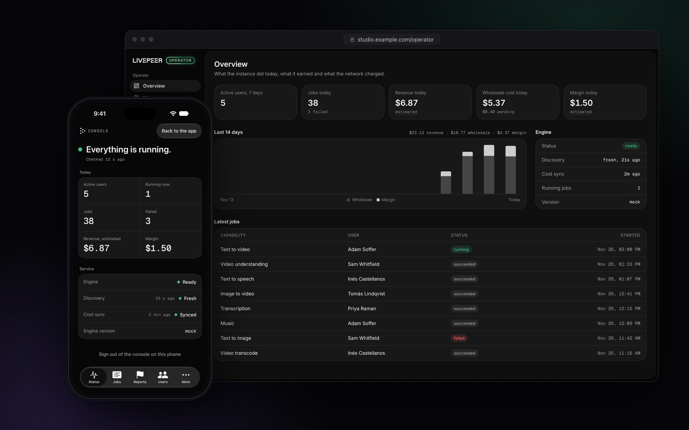
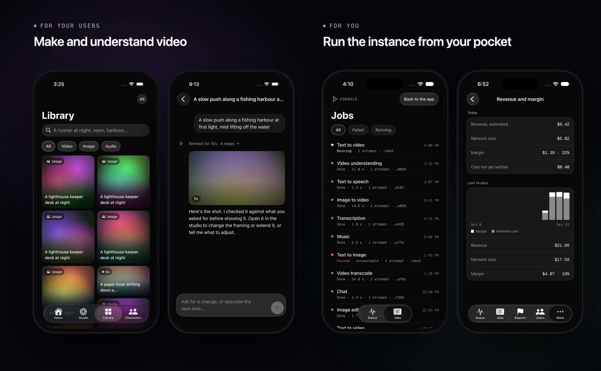

# Livepeer

The open-source video platform you own.

Use it as a ready-made video studio, or headless as the video backend for your own app. Livepeer brings the
product, the API and the console; the Livepeer Network's open market of GPUs brings the compute, paid per job.



- **Yours to run:** your name, branding, prices, users and rules, in one config file. MIT-licensed, so no one
  can switch it off for you.
- **Two ways in:** a complete app for making and understanding video, an API and MCP server for your own
  products and agents, or both.
- **One console:** choose the network's capabilities, manage users and keys, and see usage and cost job by
  job. Plans, credits and payments are there when you sell to others.
- **Simple economics:** you pay the network its wholesale cost per job. If you sell to others, they pay you in
  credits and the markup is yours.

Run it yourself with one command, or have it hosted.

## A look around

The console, where you run the instance, on the web and on your phone:



The iOS and Android apps have one side for your users and one for you:



## This repository

It holds everything that makes up an instance:

- The user app, the operator console, and the instance API and MCP server.
- The bundle that starts them together with a pinned engine.

Each surface can be switched on or off in the instance config. An instance can run the console and API
without the app (the `headless` preset), or the API alone.

The engine ([livepeer-builder-core](https://github.com/NE-Build-Track/livepeer-builder-core)) is a separate
service, reached over its REST API.

## Quick start

You need Docker with the Compose plugin and Node 22.

```bash
./livepeer setup --preset full
```

That writes `.env` (with a generated session secret) and `instance.config.json`, builds and starts the app,
and waits for its health check. With no engine keys it starts in **mock-only mode**, where every function
returns realistic mocked data, so a first run needs nothing else. Open the URL it prints.

To connect a real engine, set `ENGINE_URL`, `ENGINE_READER_TOKEN` and `ENGINE_ADMIN_TOKEN` in `.env` and run
`./livepeer setup` again. To start the engine, payment provider and signer from the same bundle, see
[deploy/README.md](deploy/README.md).

```bash
./livepeer doctor      # checks config, keys, engine and provider, and says what to fix
./livepeer upgrade     # moves the app and its pinned engine to this checkout's release
./livepeer invite-operator   # prints a link that makes whoever opens it an owner of the console
```

### The operator team

The first time `./livepeer setup` runs it prints a link. Whoever opens it and signs in becomes the first
owner of the operator console. Owners invite everyone else from **Team** in the console: pick a role (owner,
member or viewer), copy the link and send it. A link works once and lasts 72 hours. If nobody can reach the
console, `./livepeer invite-operator` prints a new owner link. The plan and its decisions are in
[docs/operator-invitations.md](docs/operator-invitations.md).

Agents: see [AGENTS.md](AGENTS.md) for exact commands, expected output and failure fixes.

## Development

```bash
corepack pnpm install
corepack pnpm dev            # http://localhost:3100, reads the root .env
MOCK_ONLY=1 corepack pnpm dev
corepack pnpm test           # runs every package's tests
corepack pnpm typecheck
```

In development a small badge on each screen says whether its data is live or mocked, and a role switch flips
between the user and operator roles. Neither is ever shown to end users.

Workspaces (shared team accounts) run on mocked data until the payment provider has them. The development
user belongs to one, "Northlight Studio", and switches to it from the account menu; `docs/workspaces.md` has
the plan and what is built.

## Folder structure

```
apps/web                  Next.js host: routes, sessions, role guard, /api/v1, /api/mcp, /api/health
apps/ios                  Native iOS app (Swift, SwiftUI): a client of an instance's /api/v1
apps/android              Native Android app (Kotlin, Compose): a client of an instance's /api/v1
packages/api-client       Types and one function per operation (live + mock), data-source map
packages/config           Instance config schema, generated types, presets, capability and surface rules
packages/db               The instance's Postgres: schema, connection, migrations and the migration runner
packages/storage          Object storage behind one interface: the S3 API, or the app's own disk in development
packages/ui               Theme tokens, primitives, motion
packages/user-app         User-app screens
packages/operator-console Operator console screens
packages/cli              livepeer setup | doctor | upgrade | invite-operator
deploy/                   Compose bundle and deploy templates
docs/                     Brief, research, design brief, route map, architecture, data sources
release.config.json       The GitHub organisation, registry and pinned engine/provider/signer versions
```

## Native apps

iOS (`apps/ios`, Swift and SwiftUI) and Android (`apps/android`, Kotlin and Compose) are native clients of an
instance's `/api/v1`. They are opt-in for operators: `./livepeer setup` never builds them, and an operator
who wants them builds and publishes their own. The plan, and what is built so far, is in
`docs/mobile/plan.md`.

A build belongs to one instance. `apps/ios/Config/Instance.xcconfig` holds the only build-time values (name,
bundle identifier, instance URL); theme, sign-in methods and features come from the instance at run time.

Phones are a surface an operator switches on (`surfaces.mobile`, off in both presets), naming the apps built
for the instance in `mobile.ios.bundleId` and `mobile.android.applicationId`: sign-in hands a session only to
those. The apps sign in in the system's own browser session and get a revocable device session of their own;
the instance keeps sessions, and reports and blocks of shared characters, in its Postgres database. The
Compose bundle runs one; with no `DATABASE_URL`, as in `pnpm dev`, the app runs a Postgres inside itself and
keeps it in `.data/`, so there is nothing to install.

Files people upload go straight from the browser or phone to object storage and never through the app's
server. Storage is anything that speaks the S3 API (Cloudflare R2, AWS S3, Backblaze B2, a server you run),
set with the `S3_*` variables in `.env.example`. The Compose bundle runs its own (Garage); with none set,
as in `pnpm dev`, the app keeps files in `.data/media` behind the same interface. `docs/media-storage.md` has the design.

The operator console on phones is a second switch (`surfaces.mobileConsole`, also off in both presets). The
server side is built: an operator's phone gets its own short-lived session, bound to a key in the phone's
secure hardware, which reads only after a face or fingerprint and needs a new one for every change; phones
are listed and revoked on the web console's System page. On iOS the first stage is built: Status, Jobs,
Reports and Users, deciding a report and suspending or resuming a user, each change confirmed with Face ID.
Android is not built yet. See `docs/mobile/plan.md` section 18. The development config below turns the console on; sign in to the app as `sam@example.test`, the
mock provider's operator, to be offered it (`adam@example.test` is an ordinary user).

```bash
# an instance with the apps switched on, for the apps to talk to, on :3100
MOCK_ONLY=1 INSTANCE_CONFIG=docs/mobile/dev.instance.config.json corepack pnpm dev
open apps/ios/Livepeer.xcodeproj              # then Run, on any iOS 18+ simulator
(cd apps/android && ./gradlew :app:installDebug)   # onto a running emulator, Android 10+
corepack pnpm mobile:generate                 # after changing tokens, operations or API types
```

The apps' design tokens, API models and client are generated (`packages/mobile-codegen`) from
`packages/ui/src/styles/tokens.css`, `apps/web/lib/public-api/operations.ts` and the API client's types. CI
fails when the generated files are out of date.

## Instance config and presets

What the console's Settings and Capabilities pages change is kept by the instance itself, laid over this
config; the config is never written by the app, and "Reset to deployed config" on either page goes back to
it. On a host with no file to mount, give the config itself in `INSTANCE_CONFIG_JSON`.

An instance is one file, `instance.config.json`, validated against
[`packages/config/schema/instance.schema.json`](packages/config/schema/instance.schema.json), plus
environment variables for secrets (see [.env.example](.env.example)). It covers the name, logo and colours,
the engine URL, which surfaces are served (user app, operator console, API, MCP), capability allow and block
rules, the auth and payment provider, pricing markup and content policy.

Two presets ship in `packages/config/presets/`:

| Preset | Serves |
|--------|--------|
| `full` | User app, operator console, API and MCP |
| `headless` | Operator console, API and MCP: no customer-facing app, as with a headless CMS |

Which capabilities an instance offers is separate from the preset. For example, a headless instance that
starts with transcoding only:

```json
{ "capabilities": { "allow": ["*transcode*"], "block": [] } }
```

## Switching a function from mock to live

Every API function has a live and a mock implementation behind one signature.
[`packages/api-client/src/data-sources.ts`](packages/api-client/src/data-sources.ts) decides which is used.

1. Implement the live call in `packages/api-client/src/live/`.
2. Branch on `resolveSource("<name>", env)` in `packages/api-client/src/index.ts`.
3. Set the function to `"live"` in `data-sources.ts`.
4. Update [docs/data-sources.md](docs/data-sources.md).

`MOCK_ONLY=1` forces every function to its mock, for tests, CI, demos and first runs.

## Licence

MIT.
